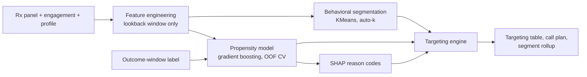
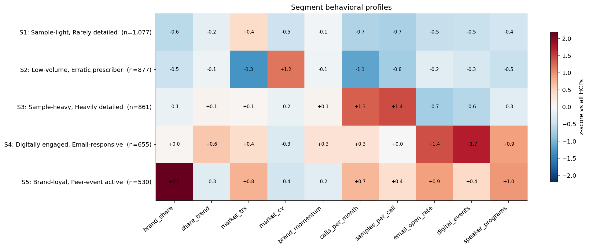
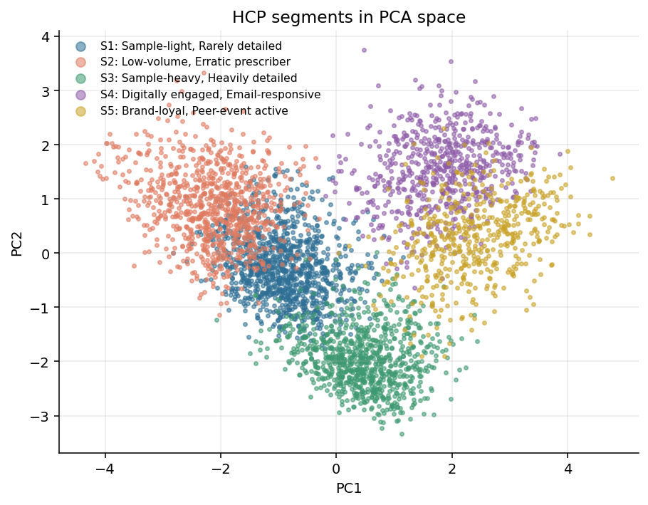
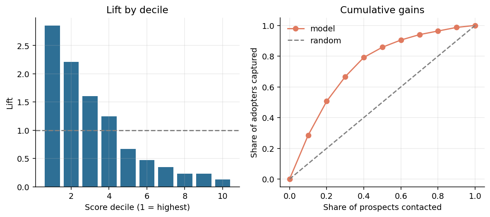
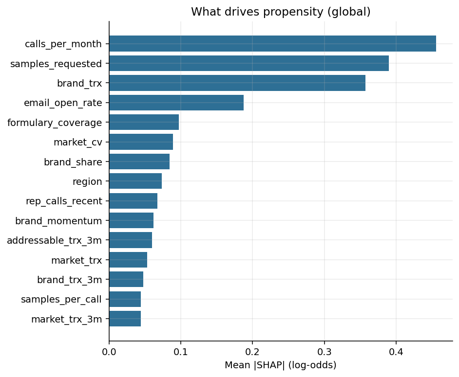
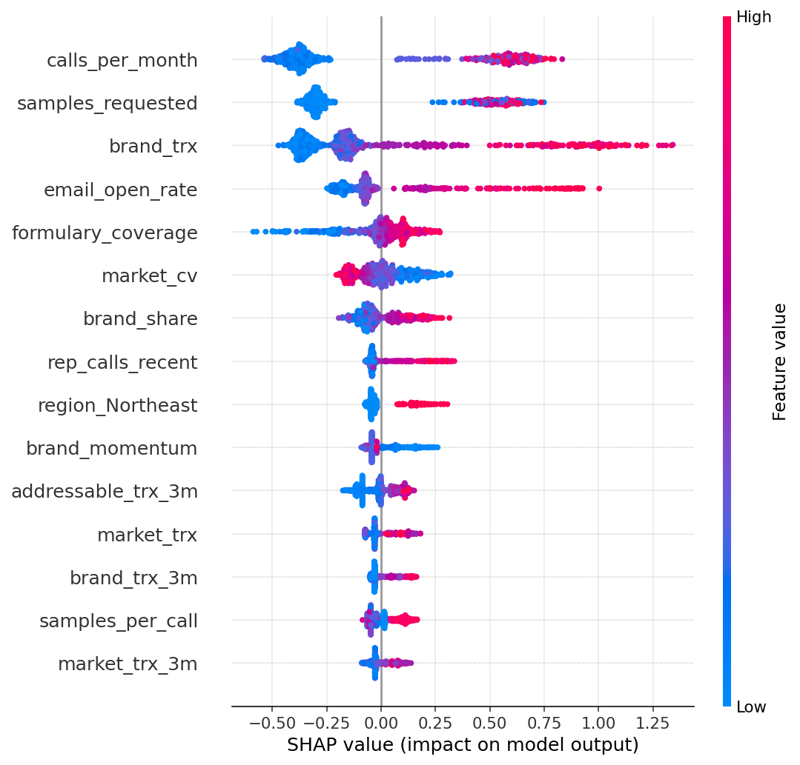

# HCP Segmentation & Targeting Engine

[](https://github.com/<your-username>/hcp-targeting-engine/actions/workflows/ci.yml)


Cluster healthcare professionals (HCPs) by **prescribing and engagement behavior**, score each one on
their **propensity to start prescribing**, explain every score with **SHAP**, and turn it all into a
prioritized, capacity-aware targeting table.

Built with scikit-learn and SHAP. Runs end-to-end on bundled synthetic data in under a minute, or on your own data.

```bash
pip install -e ".[dev]"
hcp-engine run            # writes everything to ./outputs
```

## What you get

| Question | Answer from the engine |
|---|---|
| Who are my HCPs, behaviorally? | 4-8 stable, auto-named segments (k chosen by silhouette **and** bootstrap stability) |
| Who is likely to start writing my brand next quarter? | Out-of-fold propensity score per prospect, benchmarked against logistic regression |
| *Why* is this HCP a good target? | Top SHAP drivers as plain-English reason codes, plus "watch-outs" |
| Where do I spend my call capacity? | Expected value = propensity x addressable TRx, tiered, with a recommended play and channel per HCP |



## Quickstart

```bash
git clone https://github.com/<your-username>/hcp-targeting-engine.git
cd hcp-targeting-engine
python -m venv .venv && source .venv/bin/activate
pip install -e ".[dev]"

hcp-engine run --n-hcps 4000 --capacity 300 --out outputs
pytest -q
```

Useful flags: `--k 5` (fix segment count), `--no-explain` (skip SHAP), `--input-dir DIR` (your own data, see
[`docs/data_schema.md`](docs/data_schema.md)), `--seed`.

Or from Python:

```python
from hcp_engine import Config, run_pipeline

res = run_pipeline(Config(call_capacity=250), out_dir="outputs")
res.target_table.query("in_call_plan").head()          # who to call
res.segment_opportunity                                # where the value is
res.propensity_model.predict_proba(new_features)       # score new HCPs
```

## Results on the bundled synthetic data

4,000 synthetic HCPs drawn from five hidden behavioral archetypes. Of these, 3,028 are *prospects* and 25.4% adopt the brand in the outcome quarter.
These numbers show the engine works as designed. They are **not** benchmarks for real-world performance, which is typically lower.

| Check | Result |
|---|---|
| Segmentation | k=5 chosen automatically; **ARI 0.75** against the hidden archetypes (never given to the model) |
| Propensity (5-fold CV) | ROC-AUC **0.83**, PR-AUC 0.63, Brier 0.136 |
| Targeting value | Top score decile: **72%** adopt vs 25% base rate (**2.85x lift**). Top 30% of prospects capture **67%** of adopters |
| Benchmark | Logistic regression scores AUC 0.83 too. The synthetic signal is mostly additive, so the benchmark says "simple is enough here". On real, interaction-heavy data, expect boosting to separate. |

<p align="center"></p>
<p align="center"></p>
<p align="center"></p>

Running the pipeline also writes `figures/shap_beeswarm.png` and `figures/shap_importance.png`
(global SHAP views), `calibration.png`, `k_selection.png` and `segment_opportunity.png`.

### Example output

`hcp_targeting_table.csv` (excerpt, one row per HCP):

| hcp_id | segment | propensity | tier | recommended_play | channel_hint | why_target |
|---|---|---|---|---|---|---|
| HCP003114 | S3: Sample-heavy, Heavily detailed | 0.81 | Tier 1 | Prioritize: high propensity, high potential | Rep-led | *(top SHAP drivers as text, in the format `Email open rate = 76%; Rep calls/month = 2.3`)* |

## How it works

### 1. Features (`features.py`)
Built **only** from months `1..12` of the Rx panel: brand/class TRx, brand share, volume-weighted **share trend**,
momentum (last 3 vs prior 3 months), prescribing volatility, plus rep/email/digital/speaker engagement and profile attributes.
The label is built **only** from months `13..15`. Tests tamper with each window and assert the other is untouched.

### 2. Segmentation (`segmentation.py`)
`impute -> log/sqrt skew transforms -> winsorize -> standardize -> KMeans`, on behavioral features only (no outcome).
`k` is picked by **silhouette within the stable set** (bootstrap ARI >= 0.75), preferring the smallest k within 0.01 of the best.
The search starts at k=4 because silhouette is biased toward tiny k and a 3-way split rarely supports differentiated strategy.
Segments are ordered by size and named from their most distinctive z-scores. Treat names as a starting point for human review.

### 3. Propensity (`propensity.py`)
Scope: **prospects** (HCPs below `established_writer_trx` in the last 3 lookback months). Established writers are
segmented but routed to *Retain & defend*, with an at-risk flag when momentum is falling.
Gradient boosting with early stopping, benchmarked against logistic regression in the same CV folds.
Prospects are scored with **out-of-fold** predictions, so no HCP is scored by a model that saw its label.

### 4. Explainability (`explain.py`)
SHAP `TreeExplainer` on the booster (log-odds space, additive). One-hot columns are summed back to their parent feature
(`region_West` + `region_South` -> `region`) so reason codes read naturally. Each HCP gets `why_target` (top positive drivers)
and `watch_outs` (top negative drivers); contributions under 0.05 log-odds are suppressed rather than padded.

### 5. Targeting (`targeting.py`)
`expected_value = propensity x addressable_trx_3m` ranks prospects. They are tiered (top 10% / next 20% / rest), placed on a
propensity x potential matrix (*Prioritize / Nurture / Persuade / Deprioritize*), and given a digital-vs-rep channel hint.
The top `call_capacity` form the call plan. Expected value is a transparent **ranking heuristic**, not a forecast.

## Project layout

```
src/hcp_engine/
  config.py        all tunables (windows, thresholds, k range, capacity)
  data.py          schema validation, CSV I/O, synthetic generator
  features.py      leakage-safe feature + label construction
  segmentation.py  KMeans pipeline, k selection, profiling, naming
  propensity.py    GBM + logistic baseline, OOF CV, metrics, gains/calibration
  explain.py       SHAP wrapper, one-hot grouping, reason codes
  targeting.py     expected value, tiers, plays, channel, call plan
  viz.py           figures
  pipeline.py      orchestration + artifact writing
  cli.py           `hcp-engine` entry point
tests/             leakage guards, segmentation recovery, metrics, targeting logic, end-to-end
docs/              data schema, figures
```

## Responsible use

- **No real data is included.** The generator is fully synthetic. If you run this on real HCP data, handle it under your organization's data-governance, privacy and licensing terms.
- **Promotional compliance.** Targeting drives commercial outreach. Align the use with your company's code of conduct and applicable industry and local regulations.
- **Proxies for protected attributes.** `years_in_practice` correlates with age. Drop or audit such features with `Config(exclude_features=(...))` and review SHAP output for unintended reliance. In the synthetic data it carries no signal by construction, which is a useful sanity check on the SHAP ranking.
- **Propensity is not uplift.** A high score means "likely to adopt", not "likely to adopt *because* we called". See the roadmap.

## Limitations and roadmap

- Validation uses stratified random CV on a single outcome quarter. A **temporal holdout** (train on an earlier as-of date, score a later one) is the right next test before any production use.
- Engagement is supplied as lookback-window aggregates, not event-level time series.
- Segment names are rule-based and need human review. Segments are not guaranteed to be "natural" clusters, and stability is reported, not assumed.
- Planned: uplift / next-best-action modeling, probability calibration (isotonic), monthly refresh with drift monitoring, segment-migration tracking.

## Development

```bash
make install   # editable install with dev tools
make test      # pytest
make lint      # ruff
make demo      # full pipeline run
```

CI runs lint, tests and a demo run (including SHAP) on Python 3.10-3.12.

## License

MIT, see [LICENSE](LICENSE).

---

## Verified extensions (optional, original pipeline unchanged)

The backward-compatible `hcp_engine_plus` package adds the following workflows.
They use the same installed dependencies and do not alter `hcp-engine run` or its outputs.
Read [Verification](VERIFICATION.md) for exact local checks and environment limits,
[Model Card](docs/MODEL_CARD.md) for appropriate use and known model risks, and
[Extension Guide](docs/EXTENSIONS.md) before attempting live data.

### As-of scoring and time-based evaluation

```bash
# Run the original pipeline first to train and save a model
hcp-engine run --n-hcps 800 --k 5 --out outputs
hcp-engine generate-data --n-hcps 800 --seed 42 --out data/synthetic

# Score a previously trained model against an as-of *feature snapshot*, no future labels
python -m hcp_engine_plus.cli score-asof \
  --input-dir data/synthetic --as-of 12 \
  --model outputs/models/propensity.joblib --out outputs/asof_scores.csv

# REAL forward evaluation requires two genuine chronological snapshots.
# The month field is a sequential integer index (NOT 202501, NOT YYYY-MM).
python -m hcp_engine_plus.cli temporal-holdout \
  --train-dir data/train_snapshot --train-as-of 12 \
  --test-dir data/later_snapshot --test-as-of 16 \
  --out outputs/temporal_metrics.json
```

The example `score-asof` assumes `data/synthetic` was generated using
`hcp-engine generate-data --out data/synthetic`; see the [extensions guide](docs/EXTENSIONS.md).
**Engagement aggregates MUST already be computed at each corresponding as-of month.**
Do not reconstruct an earlier engagement snapshot from later summary data.
The temporal holdout also refuses overlapping train outcomes and test feature cutoffs.

### Diagnostics, dashboard and constraints

```bash
python -m hcp_engine_plus.cli audit-data --input-dir data/synthetic --out outputs/data_quality.json
python -m hcp_engine_plus.cli audit-scores --targets outputs/hcp_targeting_table.csv \
  --group region --out outputs/region_score_audit.csv
python -m hcp_engine_plus.cli dashboard --targets outputs/hcp_targeting_table.csv \
  --out outputs/targeting_dashboard.html
```

Open `outputs/targeting_dashboard.html` locally in a browser. No server needed.
There are also Python APIs for optional held-out [probability calibration](docs/EXTENSIONS.md),
training-only parameter tuning, group score audits, population drift and bounded call plans.

### Actual SHAP demo figures (synthetic records only)





Generated by a real `shap.TreeExplainer` run on 800 synthetic HCPs (seed 42, fixed k=5).
These explain this demonstration model only. The original SHAP additivity test **was executed**;
see verification status for the environment and dependencies.

Try the notebook: [`examples/demo.ipynb`](examples/demo.ipynb).
Or open the [standalone demonstration dashboard](examples/demo_dashboard.html),
rendered entirely from synthetic records.

### Packaging

```bash
docker build -t hcp-targeting-engine .
docker run --rm -v "$(pwd)/outputs:/app/outputs" hcp-targeting-engine
# Windows PowerShell: docker run --rm -v "${PWD}/outputs:/app/outputs" hcp-targeting-engine
```

The repo includes `CONTRIBUTING.md`, `CHANGELOG.md`, a Dockerfile, optional
pre-commit hooks, and oldest-dependency compatibility testing in GitHub Actions.
The added source modules and existing 32 original tests run locally; lint, static
type-checking, Docker build and the pinned oldest dependency combinations could
not all be executed in this environment. See [VERIFICATION.md](VERIFICATION.md).

**Not implemented:** observational uplift as if it were causal, a real independent
multi-year data history, or brand-specific data modeling without an appropriate source.
The new call plan is a constrained greedy heuristic, not proven incremental effect.
